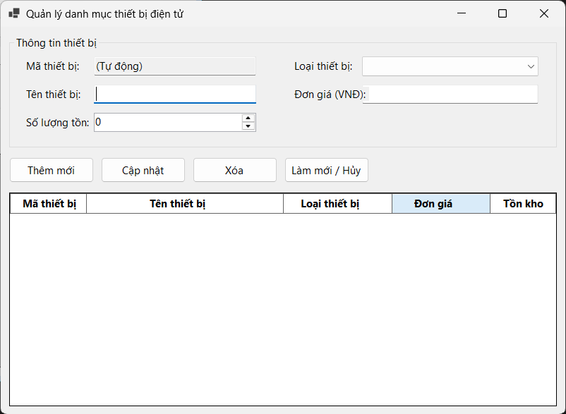
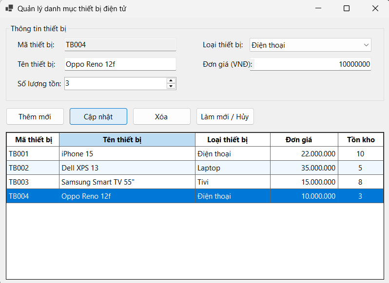
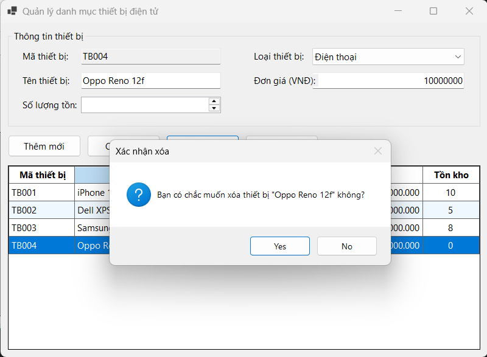
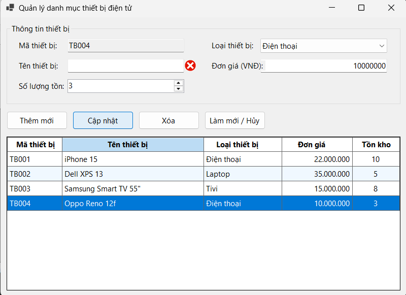
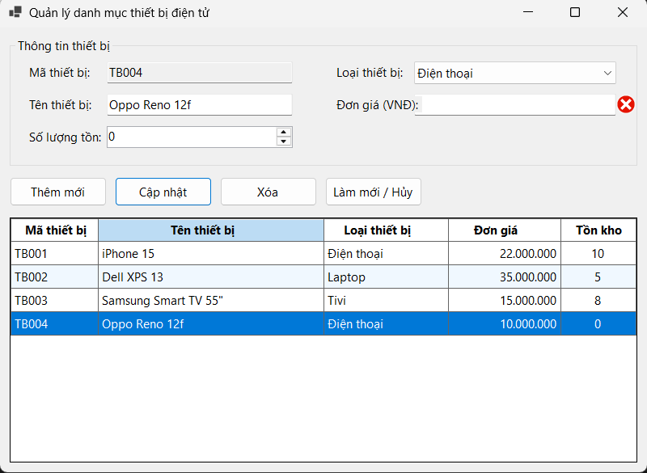

Markdown
# BÁO CÁO BÀI TẬP / ĐỒ ÁN

## THÔNG TIN SINH VIÊN
- **Họ và tên:** Nguyễn Hải Nam
- **Mã số sinh viên:** 24810310617
- **Lớp:** D20CNPM3
- **Tên môn học:** Lập trình C# / Windows Forms
- **Tên bài tập:** [BÀI 1: XÂY DỰNG ỨNG DỤNG QUẢN LÝ DANH MỤC THIẾT BỊ ĐIỆN TỬ (CƠ BẢN & DATA BINDING)]

---

## KẾT QUẢ THỰC HÀNH

### 1. Ảnh màn hình Giao diện chính

### 2. Ảnh màn hình Chức năng thực thi / Kết quả

### 2.1. Ảnh màn hình Chức năng chọn Xóa

### 3. Ảnh màn hình Kiểm tra lỗi (Validation)

