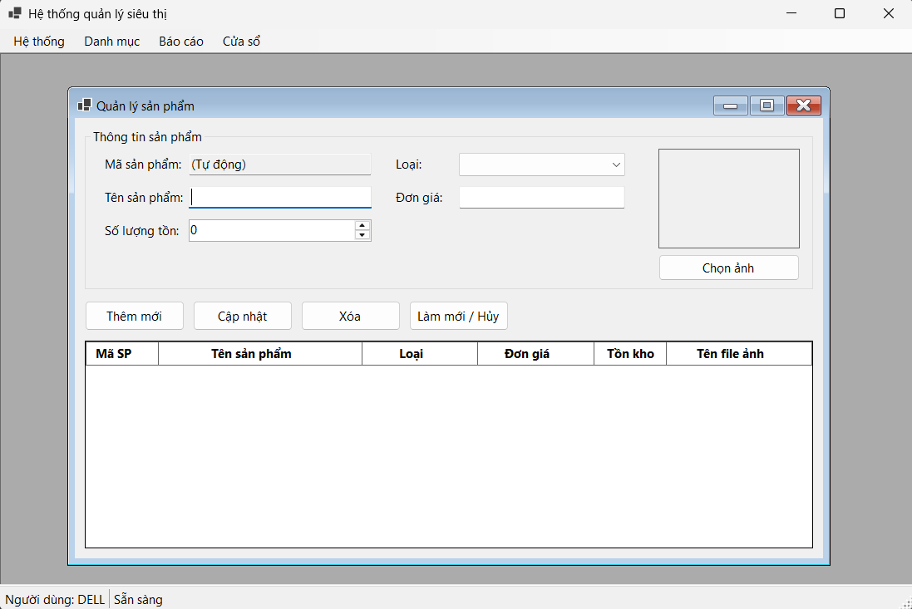
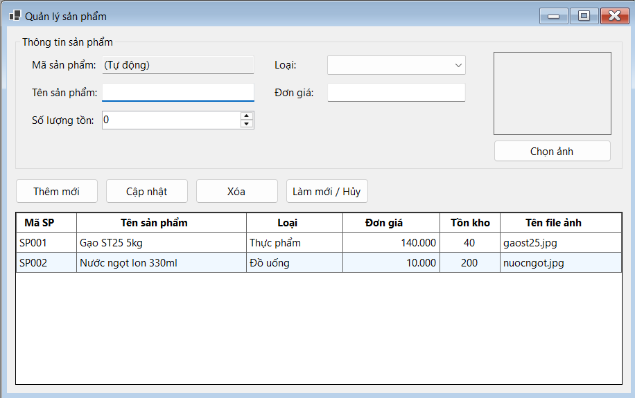
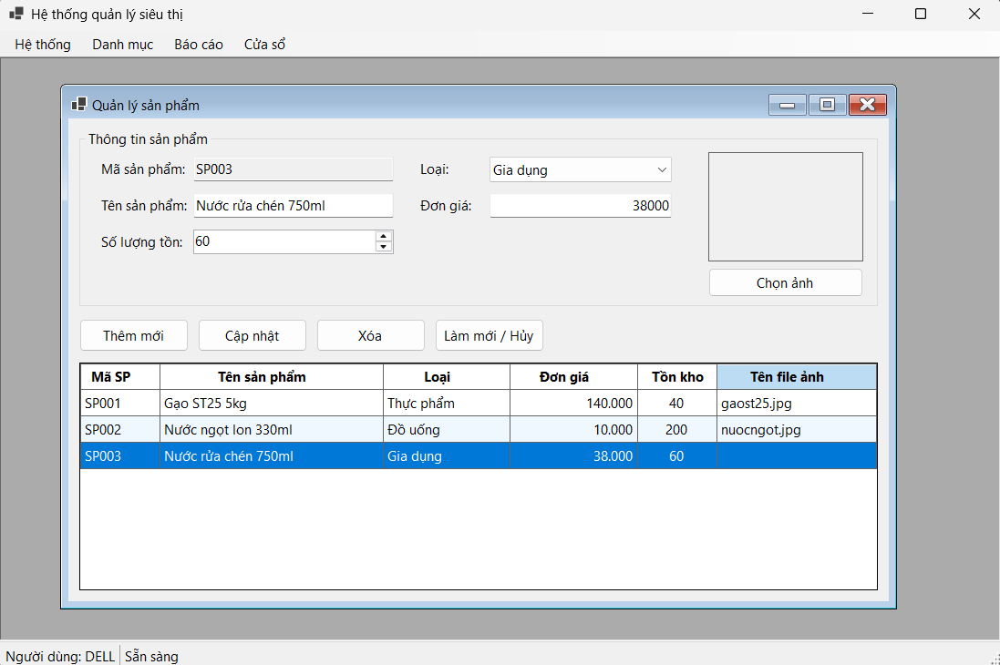
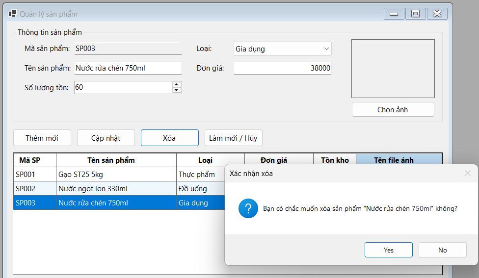
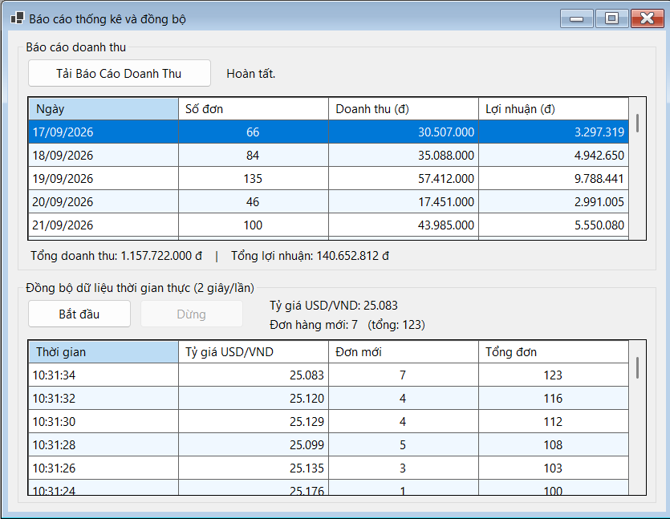
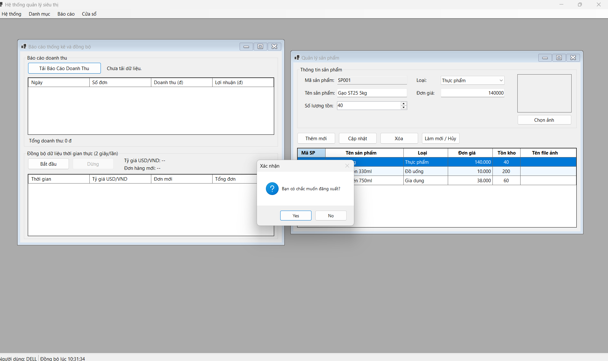
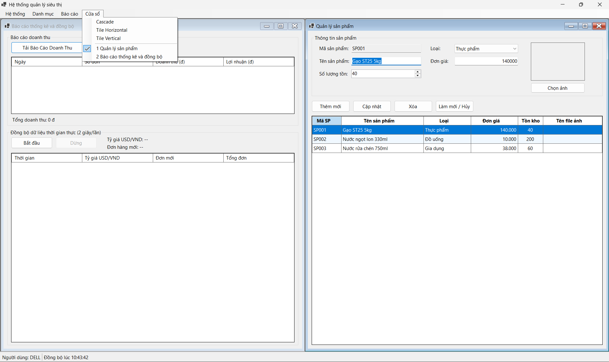
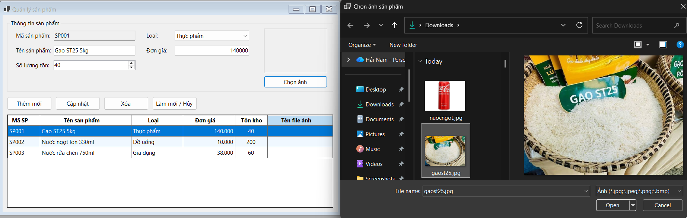
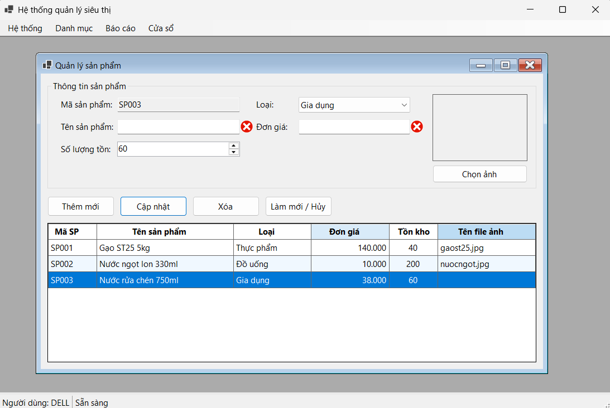

Markdown
# BÁO CÁO BÀI TẬP / ĐỒ ÁN

## THÔNG TIN SINH VIÊN
- **Họ và tên:** Nguyễn Hải Nam
- **Mã số sinh viên:** 24810310617
- **Lớp:** D20CNPM3
- **Tên môn học:** Lập trình C# / Windows Forms
- **Tên bài tập:** [BÀI 3: HỆ THỐNG MDI QUẢN LÝ SIÊU THỊ & ĐỒNG BỘ DỮ LIỆU BẤT ĐỒNG BỘ (NÂNG CAO - ASYNC/AWAIT & MULTI-THREADING)]

---

## KẾT QUẢ THỰC HÀNH

### 1. Ảnh màn hình Giao diện chính

### 2. Ảnh màn hình Chức năng thực thi / Kết quả

### 2.1 Ảnh màn hình Chức năng cập nhật sản phẩm

### 2.2 Ảnh màn hình Chức năng xóa sản phẩm

### 2.3 Ảnh màn hình Chức năng báo cáo thống kê

### 2.4 Ảnh màn hình Chức năng đăng xuất

### 2.5 Ảnh màn hình Chức năng của 2 form

### 2.5 Ảnh màn hình Chức năng chọn ảnh

### 3. Ảnh màn hình Kiểm tra lỗi (Validation)

